# AI Question Workshop: LangChain RAG Assessment Workflow

An intelligent, full-stack workflow application designed for educational content reviewers. It transforms markdown reading material into a verified, grounded five-question assessment group (2 Theory MCQs, 2 True/False, 1 Code-Analysis) in a standardized tagged format, with an interactive review, correction, and approval workflow.

Built for the **Software Development Instructor (AI FullStack)** assignment.

---

## Architecture Overview

```mermaid
flowchart LR
    subgraph Input["1. Input Layer"]
        MD["Reading Material (.md)<br/>Python Functions"]
    end

    subgraph Backend["2. LangChain RAG Backend (FastAPI + uv)"]
        Splitter["MarkdownHeaderTextSplitter<br/>& RecursiveCharacterSplitter"]
        Retriever["Structured Context Retriever<br/>(4 Chunks Indexed)"]
        Chain["LangChain LCEL Prompt Chain<br/>(Strict Chunk Adherence)"]
        LLM["Google Gemini API<br/>(or Offline Demo Fallback)"]
        
        MD --> Splitter
        Splitter --> Retriever
        Retriever --> Chain
        Chain --> LLM
    end

    subgraph Frontend["3. Reviewer Workspace (React + Vite)"]
        Split["Split-Screen UI"]
        Cards["5 Editable Question Cards<br/>(2 Theory, 2 T/F, 1 Code)"]
        Approve["Approve & Counter (5/5)"]
        Export["Tagged XML Output<br/>(Copy / Download)"]

        LLM --> Split
        Split --> Cards
        Cards --> Approve
        Approve --> Export
    end
```



---

## Key Features

1. **Strict Context Adherence via LangChain RAG**:
   - The core assignment rule states: *"A question that tests something the material does not actually teach is a failed question."*
   - Rather than relying on fragile post-hoc regular expressions or external heuristics, grounding is enforced through **Retrieval-Augmented Generation (RAG)**. The material is chunked using LangChain's `MarkdownHeaderTextSplitter`, and questions are generated strictly from the retrieved chunks. Every question cites its exact source section and passage.
2. **Reviewer-in-the-Loop Workflow**:
   - Content reviewers have full authority to inspect each question, edit prompts, alter distractor options, update correct answers, and approve questions individually or in bulk.
3. **Exact Five-Question Distribution**:
   - **Theory MCQ 1 & 2**: Theoretical multiple choice questions with 4 options (A, B, C, D) and explanations.
   - **True / False 1 & 2**: Binary concept questions (1 True, 1 False) grounded in explicit rules.
   - **Code Analysis**: Real code snippet extracted from the text, testing execution output or variable shadowing.
4. **Standardized Tagged XML Format**:
   - Instant export with one-click **Copy XML** and **Download XML** for seamless integration into question banks and LMS platforms.
5. **Zero-Setup Demonstration Fallback**:
   - Runs out of the box with the bundled reading material on **Python Functions (Arguments, Return Values, Scope)**. Works 100% offline without requiring an API key, while also supporting live Google Gemini API keys via environment variables or the UI drawer.

---

## Tech Stack

| Component | Technology | Rationale |
|---|---|---|
| **Frontend** | React 18, Vite, Lucide Icons | Fast, reactive, responsive split-screen UI with instant state updates. |
| **Backend** | Python 3.10+, FastAPI, Uvicorn | High-performance, clean REST endpoints, automatic OpenAPI documentation. |
| **RAG & AI** | LangChain, `langchain-text-splitters`, `langchain-google-genai` | Standardized document splitting, context assembly, and LCEL chaining. |
| **Package Manager** | `uv` (Astral) | Blazingly fast, deterministic virtual environments and package resolution. |

---

## Quickstart Guide

### Prerequisites
- **Python 3.10+** (managed via `uv`)
- **Node.js 18+** and **npm**

### Step 1: Start Backend (Terminal 1)
```bash
cd backend

# Using uv (recommended)
uv sync
uv run uvicorn main:app --port 8000 --reload
```
> *The backend server will start on `http://127.0.0.1:8000`.*
> *(Optional: Create a `backend/.env` file with `GOOGLE_API_KEY=your_key` if you wish to run live Gemini generations outside the offline demo).*

### Step 2: Start Frontend (Terminal 2)
```bash
cd frontend
npm install
npm run dev
```
> *Open your browser at `http://localhost:5173`.*

---

## How Grounding Is Handled

The assignment sets one crucial rule:
> *"A question that tests something the material does not actually teach is a failed question. How you deal with that is your call."*

### Our RAG-First Approach:
1. **Semantic Section Chunking**:
   LangChain's `MarkdownHeaderTextSplitter` splits the document along `#`, `##`, and `###` headers. Code blocks (` ```python `) are parsed and associated with their respective conceptual section.
2. **Constrained Prompting**:
   The prompt template instructs the model:
   *"Generate questions based STRICTLY and ONLY on the provided chunks. Do NOT introduce external concepts not mentioned."*
3. **Source Citation Tracing**:
   Each question is tagged with its origin chunk (`source_chunk`) and the verbatim quote (`source_quote`) from the reading material that proves the correct answer.
4. **Human Reviewer Safeguard**:
   If a question needs refinement, the human reviewer has an inline editor right in the interface to modify question text, choices, or explanations before exporting.

---

## Design Decisions & Trade-offs

### 1. LangChain RAG vs Post-Hoc Regex Grounding
- **Decision**: Use LangChain's markdown chunker and retrieval pipeline to ground questions at generation time.
- **Trade-off**: RAG structures the input context to prevent hallucination upfront, rather than letting an unconstrained model hallucinate and attempting to detect failures later with fragile string-matching heuristics.

### 2. Split-Screen Reviewer UX vs Multi-Step Wizard
- **Decision**: Side-by-side view (reading material on the left, reviewer cards on the right).
- **Trade-off**: Reviewers can simultaneously compare the question and citation with the original source text without switching tabs or losing context.

### 3. Dual-Mode Generation (Live Gemini + Offline Demo Fallback)
- **Decision**: Support live Google Gemini API keys via the UI or `.env`, while bundling an offline fallback loaded with pre-verified questions on Python Functions.
- **Trade-off**: Ensures that evaluators, reviewers, or video recording sessions never fail due to API quotas, network disconnects, or missing keys.

### 4. `uv` for Python Package Management
- **Decision**: Adopt Astral's `uv` for backend environment management.
- **Trade-off**: Virtual environment creation and package installation takes under 2 seconds, eliminating slow `pip` builds and cross-platform wheel resolution issues.

---

## Tagged Format Example

```xml
<question_group topic="Python Functions Assessment" total_questions="5">
  <question id="1" type="theory_mcq" status="approved">
    <prompt>According to the reading material, what is the syntactic rule for parameters with default values in Python?</prompt>
    <options>
      <option key="A" correct="false">They must always appear before parameters without default values.</option>
      <option key="B" correct="true">They must always follow parameters without default values.</option>
      <option key="C" correct="false">They can be placed in any arbitrary position in the parameter list.</option>
      <option key="D" correct="false">They can only be used if the function returns multiple values.</option>
    </options>
    <correct_answer>B</correct_answer>
    <explanation>In Python function definitions, parameters with default values must always follow parameters without default values.</explanation>
    <source_chunk>## 1. Defining Functions and Arguments</source_chunk>
    <source_quote>In Python, parameters with default values must always follow parameters without default values.</source_quote>
  </question>
  ...
</question_group>
```

---

## Part B: Video Recording & Teaching Guide

A complete 10–15 minute recording script and walkthrough outline is available in:
📁 [`docs/RECORDING_GUIDE.md`](./docs/RECORDING_GUIDE.md)

It contains:
- **0:00 – 3:00**: Project architecture & tech choices explanation.
- **3:00 – 8:00**: Live tool demonstration (input material -> RAG generation -> review & edit -> tagged export).
- **8:00 – 13:00**: Instructor teaching demonstration: *Python Functions (Default Arguments & Local vs Global Scope)* for beginners.
- **13:00 – 14:30**: Conclusion & submission notes.

---

## Submission Details

- **Frontend**: React 18 + Vite (`/frontend`)
- **Backend**: FastAPI + LangChain (`/backend`)
- **Package Management**: `uv` & `npm`
- **Submission Form**: [Google Form Link](https://docs.google.com/forms/d/e/1FAIpQLSemR1UQisZVOTIJ5y1DOhHKotmDzYe-m3r67z4v7SawRHx0Wg/viewform?usp=header)
